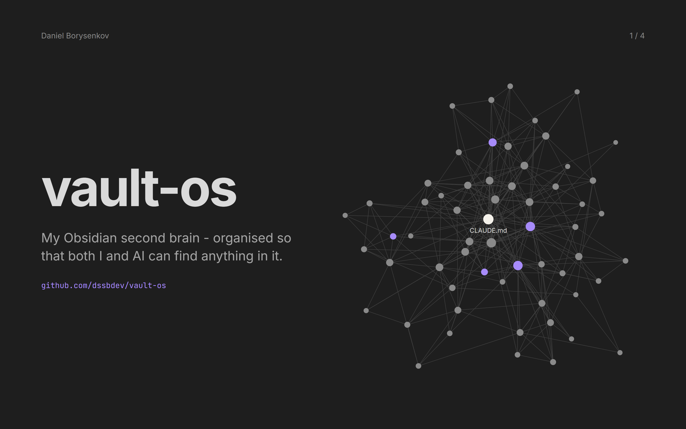
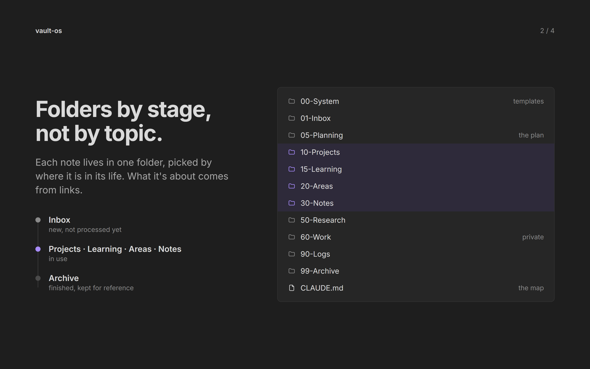
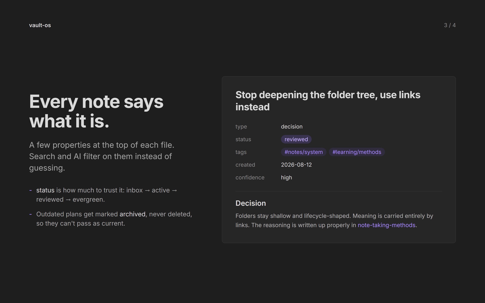
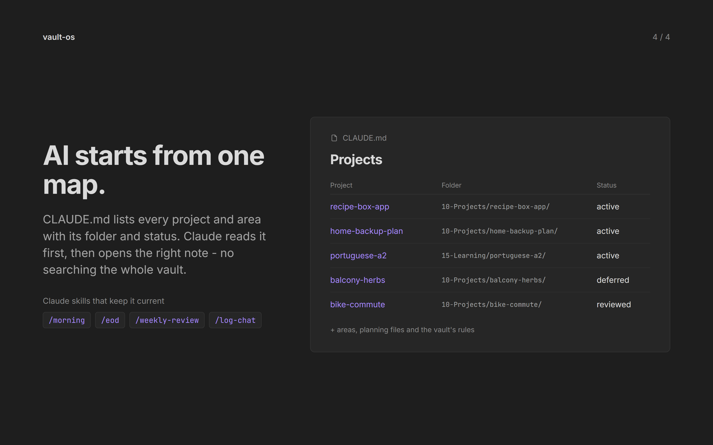

# vault-os

My Obsidian second brain, organised so that both I and AI can find anything in it.

This repo is the system behind it: how the folders are laid out, what every note says about itself at the top, how one plan keeps only three things open at a time, and the map an AI assistant reads before anything else. It comes with a demo vault you can open in Obsidian and explore. Everything in the demo vault is made up.

## The folders

| Folder | What goes there |
|---|---|
| `00-System` | Templates, one for each kind of note |
| `01-Inbox` | New ideas, not sorted yet. Parked ideas wait here too |
| `05-Planning` | The plan: the roadmap, the current two weeks, today, and dated reminders |
| `10-Projects` | Things with a finish line |
| `15-Learning` | What I'm learning, one subject at a time, and the courses |
| `20-Areas` | Things I look after that never finish |
| `30-Notes` | What I know well enough to explain |
| `50-Research` | Long comparisons and reports |
| `60-Work` | Private, never shared or searched |
| `90-Logs` | Decisions and weekly reviews, by date |
| `99-Archive` | Finished or dropped, kept for the reasoning |
| `CLAUDE.md` | The map: every project and area, where it lives and how it's doing |

## How the plan works

The roadmap is the only list of what's open. Every project sits in one group on it: Now, Next, Frozen, Done, Killed or Not now. Only three things are Now at once: one thing I'm building, one thing at home and one thing I'm learning. A new idea waits in the inbox, and it gets in only by replacing one of those three at the review every two weeks. Each day has one main task and at most two others.

## Try it

Open the `obsidian-vault` folder as a vault in Obsidian, start from `CLAUDE.md` and follow the links. The plan starts at `05-Planning/roadmap.md`.
